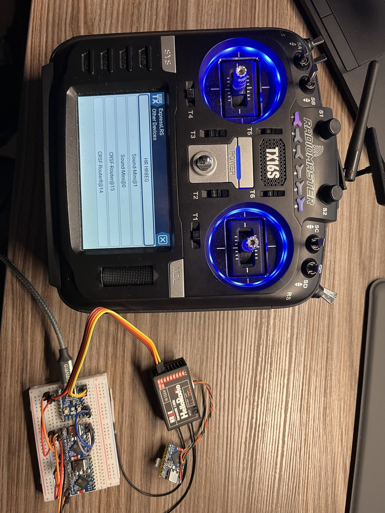
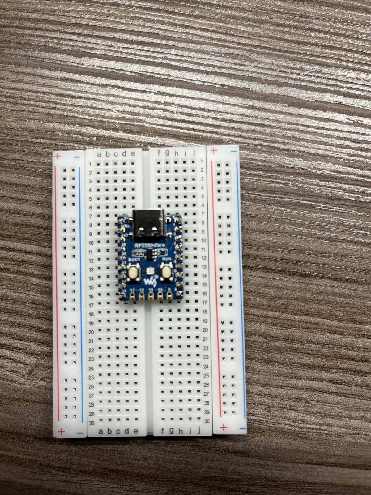

# RC-CRSF-Router-RP2350 („CRSF-Router 8“)

CRSF-Verteiler für ELRS-Empfänger auf einem **Waveshare RP2350-Zero**. Der große Bruder des [RC-CRSF-Router-ESP32-S3](https://github.com/mnorden81/RC-CRSF-Router-ESP32-S3): gleiche Weiterleitungsregeln, gleiche Bedienung über das Lua-Menü, aber bis zu 7 statt 2 Ports und **kein WLAN**.

Zwei Versionen, ein Sketch (Auswahl oben in `pins.h`):

| Version | Ports | Pins am RP2350-Zero | Im Sender | Platine |
|---|---|---|---|---|
| **Router** | Eingang + 7 Ports | alle, auch die 5 Pads an der Unterkante | `CRSF-Router8@15` | [hardware/Router](hardware/Router/) |
| **Test** | Eingang + 6 Ports | nur die beiden seitlichen Stiftleisten | `CRSF-Router8 Test@15` | [hardware/Test](hardware/Test/) |

> Stand: Firmware **v0.4.0** („Version 2“: Filter, Telemetrie-Bremse, Geräteliste, Halbduplex), kompiliert und mit Host-Tests geprüft, **noch nicht auf Hardware getestet**. Erster Hardwaretest am 05.11.2026 auf dem Steckbrett (v0.2.0, nur seitliche Stiftleisten): der Sender findet den Router als „CRSF-Router8@14“ neben dem S3-Router und zwei Sound-Minis.

| Testaufbau | RP2350-Zero auf dem Steckbrett |
|---|---|
|  |  |

## Was er macht

Der Router hängt an einem freien CRSF-Port des Empfängers und verteilt CRSF auf bis zu 7 Geräte (Test-Version: 6): Multiswitche (auch die Ziege-One-Module), Soundmodule, Sensoren oder weitere Router.

- Vom Empfänger nach unten geht alles, außer Anfragen an die eigene Adresse.
- Von unten nach oben geht alles (Telemetrie, Lua-Antworten, DEVICE_INFO).
- Zwischen den Ports geht nichts, so entstehen keine Schleifen.
- Weitergegeben werden nur vollständige Frames mit gültiger CRC, unverändert.
- Jeder Port hat eine eigene Warteschlange und sendet nicht blockierend. Ein langsamer Port bremst die anderen nicht aus. Wird es eng, fällt zuerst ein alter RC-Frame weg, Lua-Antworten bleiben erhalten.

### Neu in v0.4.0 („Version 2“)

Die Ideen stammen aus dem Vergleich mit dem CRSF-Switch von Wilhelm Meier (wmucpp). Ohne Änderung im Lua-Menü verhält sich der Router genau wie v0.3.0.

| Funktion | Was sie macht | Wirkt |
|---|---|---|
| **Filter je Port** | RC-Kanäle (0x16/0x17) und LinkStats (0x14/0x1C/0x1D) nach unten je Port an oder aus. Ping, Lua und Schaltbefehle gehen immer durch. | sofort |
| **Telemetrie-Bremse je Port** | Telemetrie von unten nach oben: alle, höchstens 50/20/10/5/2/1 Frames pro Sekunde **je Sensor-Art**, oder aus. Bei RPM, Temperatur und Zellen zählt jede Quelle einzeln. DEVICE_INFO und Lua-Antworten gehen immer hoch. | sofort |
| **Geräteliste** | Der Router fragt 2 s und 6 s nach dem Start alle Ports per Ping ab und merkt sich die Antworten (bis 4 Geräte je Port, auch hinter einem weiteren Router). Lua-Ordner „Geräte“ zeigt sie, „Geräte suchen“ fragt neu ab. Antworten auf den eigenen Ping bleiben im Router. Die USB-Konsole listet jede Änderung. | sofort |
| **Halbduplex je Port** | Port 1 und 3–7 (PIO-Ports) können auf einem Draht arbeiten: Signal des Geräts an den **TX-Pin** des Ports, RX-Pin bleibt frei. Der Router sendet nur bei freier Leitung und lässt dem Gerät nach jedem Frame 0,6 ms Zeit zum Antworten. Port 2 (Hardware-UART) kann nur Vollduplex. | nach Neustart |

Zum Merken: Schaltet man an einem Port die RC-Kanäle ab, sieht ein Gerät dort (auch ein weiterer Router) kein RC-Signal mehr und geht in Failsafe. Halbduplex ist nur für Geräte gedacht, die selbst Halbduplex sprechen (ein Draht für beide Richtungen, nicht invertiert).

## Status-LED (RGB-LED auf dem Board)

| LED | Bedeutung |
|---|---|
| grün langsam | RC-Signal in Ordnung |
| rot schnell | kein RC-Signal / Failsafe |
| gelb Doppelblitz | Adresskonflikt oder ein Port ließ sich nicht starten |

Sind Rot und Grün vertauscht, im Lua-Menü „LED Farbfolge“ auf **RGB** stellen.

## Lua-Menü (ELRS Lua / TBS Agent)

Ab v0.4.0 werden die Feld-IDs fortlaufend vergeben, sie haben sich gegenüber v0.3.0 verschoben (nur wichtig für eigene Skripte). Die Einstellungen aus v0.3.0 übernimmt der Router beim ersten Start.

| Eintrag | Werte |
|---|---|
| Version | z. B. „0.4.0 Router“ |
| Ordner **Ports (nach Neustart)** | |
| ↳ Port 1 … Port 7 | Aus, 57600, 115200, 400000, **420000**, 921600 |
| ↳ Port 1 Leitung, Port 3 … 7 Leitung | **Voll (TX+RX)**, Halb (nur TX) |
| Ordner **Filter** → je Port ein Ordner | |
| ↳ RC-Kanaele runter | Aus, **Ein** |
| ↳ LinkStats runter | Aus, **Ein** |
| ↳ Telemetrie hoch | **Alle**, 50/s, 20/s, 10/s, 5/s, 2/s, 1/s, Aus |
| Ordner **Geraete** | |
| ↳ Geraete suchen | Nein, Jetzt |
| ↳ Port 1 … Port 7 | Anzeige, z. B. „Multiswitch@3, Sound@2“, „kein Geraet“, „aus“ |
| Modul Adresse | 0–15, Vorgabe **15** |
| Ordner **Telemetrie** | |
| ↳ Spannung senden | **Aus**, als RxBt, als Zellen |
| ↳ Spannung Korrektur | −0,5 … +0,5 V |
| ↳ Spannung | Anzeige |
| ↳ Temperatur senden | **Aus**, Ein |
| ↳ Chiptemperatur | Anzeige |
| Ordner **Status** | |
| ↳ Frames runter / hoch / Verworfen / Gefiltert / CRC-Fehler unten | Zähler |
| ↳ Adresskonflikt | ja/nein |
| ↳ Ports aktiv | je Port: Nummer = Gerät antwortet, `.` still, `-` aus, `!` Fehler |
| LED Farbfolge | **GRB**, RGB |
| Neustart | Nein, Jetzt |
| Geraetename | „CRSF-Router8“ bzw. „CRSF-Router8 Test“ |

Router: 71 Felder, Test: 64 Felder (Port 7 fehlt überall). Im Sender erscheint der Router als **CRSF-Router8@15** bzw. **CRSF-Router8 Test@15** (Name@Adresse).

## Mehrere Router

Jeder Router hat eine eigene WM-Adresse (0–15 → CRSF 0xC0 + Adresse). Mehrere Router im Modell (auch gemischt mit dem S3-Router) bekommen verschiedene Adressen, z. B. 15, 14, 13. Meldet ein Gerät weiter hinten dieselbe Adresse, blinkt die LED gelb. Router lassen sich verketten; mehr als 3 Router hintereinander sind nicht sinnvoll (je ca. 0,6 ms Verzögerung).

## Anschlüsse (Kurzfassung)

| Port | Router TX | Router RX | Test TX | Test RX | Art |
|---|---|---|---|---|---|
| Uplink (Empfänger) | GP0 | GP1 | GP0 | GP1 | Hardware-UART, fest 420000 Baud |
| Port 1 | GP2 | GP3 | GP2 | GP3 | PIO-UART (Halbduplex möglich) |
| Port 2 | GP4 | GP5 | GP4 | GP5 | Hardware-UART |
| Port 3 | GP6 | GP7 | GP6 | GP7 | PIO-UART |
| Port 4 | GP8 | GP9 | GP8 | GP14 | PIO-UART |
| Port 5 | GP10 | GP11 | GP15 | GP27 | PIO-UART |
| Port 6 | GP12 | GP13 | GP28 | GP29 | PIO-UART |
| Port 7 | GP14 | GP15 | – | – | PIO-UART |
| Spannung | GP26 | | GP26 | | Teiler 33k/10k, optional |

Lage am Board (Oberseite, USB oben): rechte Leiste GP0–GP8, untere Kante GP9–GP13 (nur Lötpads), linke Leiste 5V, GND, 3V3, GP29, GP28, GP27, GP26, GP15, GP14. Die **Router**-Version braucht die Pads unten (5er-Stiftleiste einlöten), die **Test**-Version kommt mit den beiden seitlichen Leisten aus. Mehr als 8 UARTs (2 Hardware + 6 PIO) schafft der RP2350 nicht, deshalb sind 7 Ports das Maximum.

TX des Routers an RX des Geräts und umgekehrt, GND gemeinsam. Bei **Halbduplex** (Port 1, 3–7) kommt der eine Signaldraht des Geräts an den TX-Pin des Ports, der RX-Pin bleibt frei. Details und Schaltplan: [hardware/README.md](hardware/README.md).

## Flashen

**Ohne Software:** BOOT-Taste gedrückt halten und das USB-C-Kabel einstecken. Am PC erscheint das Laufwerk **RP2350**. Die passende `.uf2`-Datei (aus GitHub Actions: `CRSF-Router8_Router.uf2` oder `CRSF-Router8_Test.uf2`, oder aus der Arduino IDE) darauf ziehen, der Router startet von selbst neu.

**Arduino IDE:**
1. Datei → Einstellungen → Zusätzliche Boardverwalter-URLs:
   `https://github.com/earlephilhower/arduino-pico/releases/download/global/package_rp2040_index.json`
2. Boardverwaltung: „Raspberry Pi Pico/RP2040/RP2350“ Version **6.3.2** installieren.
3. Board **Waveshare RP2350 Zero** wählen, `firmware/RC_CRSF_Router_RP2350/RC_CRSF_Router_RP2350.ino` öffnen.
   Version wählen: oben in `pins.h` steht `#define VARIANTE_ROUTER` (Vorgabe). Für die Test-Version diese Zeile mit `//` auskommentieren und bei `//#define VARIANTE_TEST` die `//` entfernen.
4. Beim allerersten Mal mit gedrückter BOOT-Taste einstecken, Port „UF2 Board“ wählen, Hochladen. Danach geht es ohne Taste über den COM-Port.

Keine weiteren Bibliotheken nötig. Der serielle Monitor (115200) zeigt alle 10 s eine Statuszeile.

## Aufbau des Repos

| Ordner | Inhalt |
|---|---|
| `firmware/RC_CRSF_Router_RP2350/` | Arduino-Sketch (siehe [firmware/README.md](firmware/README.md)) |
| `tests/` | Host-Tests des Routers (`sh tests/run_tests.sh`) |
| `hardware/Router/`, `hardware/Test/` | KiCad-Projekte der beiden Versionen (siehe [hardware/README.md](hardware/README.md)) |
| `docs/` | Projektbeschreibung (DOCX), Fotos unter `docs/bilder/` |

## Herkunft

Die CRSF-Bibliothek stammt aus RC_Common (CRSF_ESP32 1.1.0), Basis ist [CRSF_ESP32 von Ziege-One](https://github.com/Ziege-One/CRSF_ESP32) (GPL-3.0).
