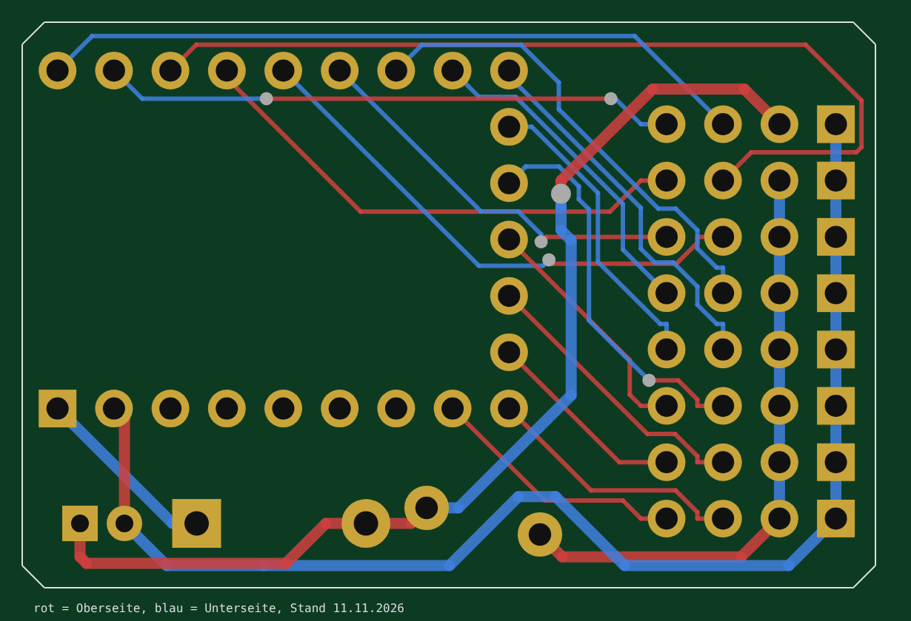

# Hardware CRSF-Router 8

Basis ist ein **Waveshare RP2350-Zero** (ca. 23,5 × 18 mm, USB-C, RGB-LED an GP16, BOOT- und RESET-Taste), gesteckt auf eine Verteilerplatine. Jeder Teilnehmer bekommt ein 4-poliges Kabel mit GND, +V und den beiden Signalen, wie bei einem Servoverteiler.

Es gibt **eine** Platine für den Router (Ordner [`Router/`](Router/)): Eingang + 7 Ports, alle Bauteile bedrahtet (THT), 38,4 × 25,5 mm, 2 Lagen. Sie nutzt alle Pins am RP2350-Zero, also beide seitlichen Leisten **und** die 5 Pads unten (GP9–GP13). Firmware-Version `VARIANTE_ROUTER` in `firmware/RC_CRSF_Router_RP2350/pins.h` (Vorgabe).

Die Firmware-Version **Test** (`VARIANTE_TEST`, Eingang + 6 Ports, nur die seitlichen Leisten) ist nur für den Aufbau auf dem Steckbrett gedacht. Für sie gibt es keine Platine.

> Stand 11.11.2026: **Platine geroutet** (von Martin in KiCad 9 mit Freerouting): 144 Leiterbahn-Stücke, 6 Vias, beide Lagen, keine GND-Fläche. Alle 20 Netze vollständig verbunden, keine Kurzschlüsse (geprüft aus der .kicad_pcb). Vor der Bestellung: DRC in KiCad, Gerber erzeugen, Footprint des RP2350-Zero am echten Board und Abmessungen von F1 im Datenblatt vor der Bestellung prüfen. Mehr als 8 UARTs schafft der RP2350 nicht (2 Hardware-UARTs + 6 PIO-UARTs), deshalb sind 7 Ports das Maximum.

| Bestückung | Leiterbahnen (rot oben, blau unten) |
|---|---|
|  |  |

3D-Modell (vereinfachte Bauteilkörper, Maße aus der Platine): [`3d-modell.html`](3d-modell.html) herunterladen und im Browser öffnen (braucht Internet für die 3D-Bibliothek).

## Aufbau so kompakt wie möglich (11.11.2026)

- Platine 38,4 × 25,5 mm: links der RP2350-Zero (USB-C ragt etwas über die Kante), darunter in einer Reihe parallel zum Zero C1, D1 (liegend) und F1, rechts die Steckerleiste.
- Keine Befestigungslöcher. Befestigung z. B. mit doppelseitigem Klebeband oder Schrumpfschlauch.
- Beschriftung (Name, T/R/V/G-Erklärung, Hinweis „kein HV-BEC“) auf der Unterseite. Oben nur T R V G und die Reihen U, 1–7.
- Steckerleiste in der Reihenfolge **T R V G** (Signale zum RP2350 hin, GND außen), damit TX/RX auf kurzem Weg zum Zero laufen. Signale 0,2 mm, Abstand 0,2 mm: zwischen zwei Pads der Leiste passt eine Leiterbahn.

## Versorgung

- **Nur vom Empfänger:** Die 5–6 V kommen über die Reihe U (Pin V) vom Empfänger-BEC. Es gibt keinen eigenen BEC-Eingang. **Kein HV-BEC (7,4/8,4 V) am Empfänger!**
- **Kein Spannungsregler:** Der RP2350-Zero bekommt VBUS über D1 (1N5819, ca. 0,3 V Verlust) an seinen 5-V-Pin. D1 verhindert, dass USB den Empfänger und die Ports speist.
- **Eine gemeinsame Sicherung** F1 (PTC 3 A) für alle Ports. Bei einem Kurzschluss an einem Port läuft der Empfänger weiter. Nach Beseitigung des Fehlers schaltet sie selbst wieder ein.
- C1 (100 µF) puffert kurze Stromspitzen der Module. Ohne ihn läuft der Router auch.
- Hat ein Modul eine eigene Versorgung, bekommt es einfach kein V-Kabel, damit zwei Netzteile nicht gegeneinander arbeiten.
- Große Verbraucher (Lasten der Multiswitche, Lautsprecher-Verstärker) nicht über diese Platine versorgen.
- **Keine Spannungsmessung:** GP26 bleibt frei, in Lua „Spannung senden“ aus lassen.

## Stückliste

| Ref | Anzahl | Wert | Bauform | Hinweis |
|---|---|---|---|---|
| U1 | 1 | Waveshare RP2350-Zero | direkt aufgelötet | Randkontakte auf die Pads gelötet, ohne Buchsenleisten |
| D1 | 1 | 1N5819 | DO-41, liegend (RM 7,62) | VBUS zum 5-V-Pin, kein Rückstrom bei USB |
| F1 | 1 | PTC 3 A / 16 V, Bourns MF-RG300 | radial, stehend | gemeinsame Sicherung aller Ports |
| C1 | 1 | 100 µF / 10 V | Elko radial Ø 5 mm, RM 2 | puffert Stromspitzen, kann zur Not entfallen |
| J1–J8 | 8 | Stiftleiste 1×4 | 2,54 mm, gerade | Uplink + Port 1–7 |

## KiCad-Projekte

Der Ordner `Router/` enthält ein vollständiges Projekt:

| Datei | Inhalt |
|---|---|
| `RC-CRSF-Router-RP2350.kicad_pro/.kicad_sch/.kicad_pcb` | Projekt, Schaltplan, Platine |
| `RC-CRSF-Router-RP2350_Schaltplan.pdf` | Schaltplan als PDF |
| `Router8.kicad_sym`, `footprints.pretty/` | Projektbibliothek: Symbol und Footprint RP2350-Zero, Stiftleiste 1×4 für die Schiene |
| `sym-lib-table`, `fp-lib-table` | binden die Projektbibliothek ein |
| `vorschau-platine.png` | Bild der Platine von oben (Bestückung) |
| `vorschau-routing.png` | Leiterbahnen beider Lagen |

Aktuell im KiCad-9-Format gespeichert. Leiterbahnen für TX/RX 0,2 mm (bei 420 kBaud und wenigen mA völlig ausreichend), Netzklasse **Power** (GND, VBUS, +5V, +V der Ports) 0,5 mm (trägt ca. 1,5–2 A), Abstand 0,2 mm, Via 0,6/0,3 mm. Das kann jeder übliche Platinenhersteller.

**Nächste Schritte:** DRC in KiCad, optional GND-Fläche auf der Unterseite, dann Gerber und Bohrdaten für den Hersteller erzeugen.

**RP2350-Zero direkt aufgelötet:** Das Board liegt flach auf der Platine, seine Randkontakte werden auf die Pads gelötet (alternativ kurze Stiftleisten durch beide Platinen). Dabei auch die 5 Pads an der Unterkante (GP9–GP13) verlöten. Vor dem Auflöten die Firmware einmal per USB aufspielen und testen.

## Steckerleiste (2,54 mm, gerade)

| Reihe | Bedeutung |
|---|---|
| U (J1) | Uplink zum Empfänger, von hier kommt die Versorgung |
| 1–7 (J2–J8) | Port 1–7, +V über die Sicherung F1 |

Spalten von links: **T** = Router empfängt, vom TX des Geräts, **R** = Router sendet, an RX des Geräts, **V** = +5–6 V, **G** = GND (eckiges Pad, rechts außen). Damit wird jedes Kabel gerade gesteckt.

## Pinbelegung RP2350-Zero

Die Spalten „Test“ gelten nur für den Steckbrett-Aufbau ohne Platine.

| Port | Router TX | Router RX | Test TX | Test RX |
|---|---|---|---|---|
| Uplink (Hardware-UART0) | GP0 | GP1 | GP0 | GP1 |
| Port 1 (PIO) | GP2 | GP3 | GP2 | GP3 |
| Port 2 (Hardware-UART1) | GP4 | GP5 | GP4 | GP5 |
| Port 3 (PIO) | GP6 | GP7 | GP6 | GP7 |
| Port 4 (PIO) | GP8 | GP9 | GP8 | GP14 |
| Port 5 (PIO) | GP10 | GP11 | GP15 | GP27 |
| Port 6 (PIO) | GP12 | GP13 | GP28 | GP29 |
| Port 7 (PIO) | GP14 | GP15 | – | – |
| frei | GP26–GP29 | | GP26, GP9–GP13 (Pads) | |

Lage am Board (Oberseite, USB oben): rechte Leiste GP0–GP8, untere Kante GP9–GP13 (nur Pads), linke Leiste 5V, GND, 3V3, GP29, GP28, GP27, GP26, GP15, GP14.
