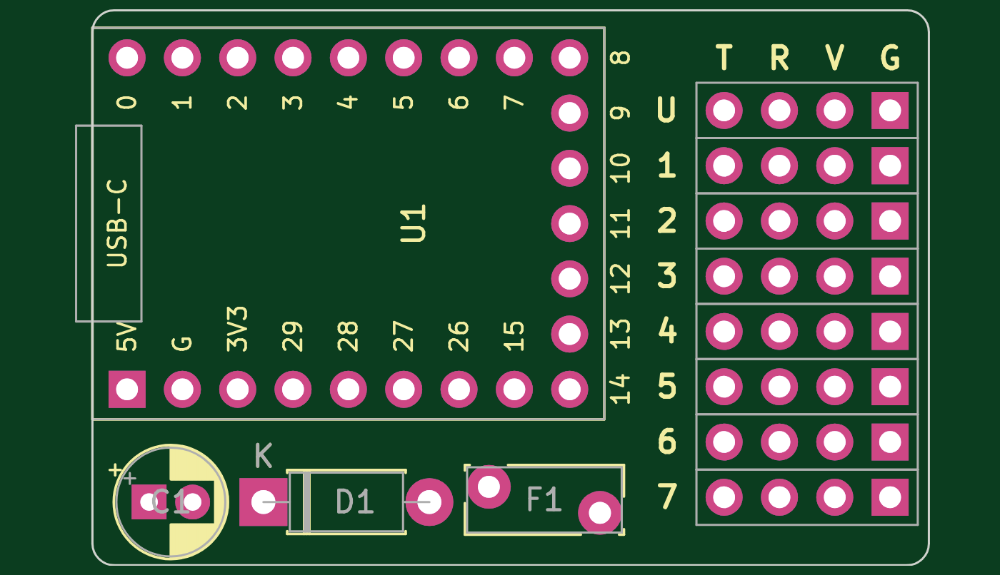
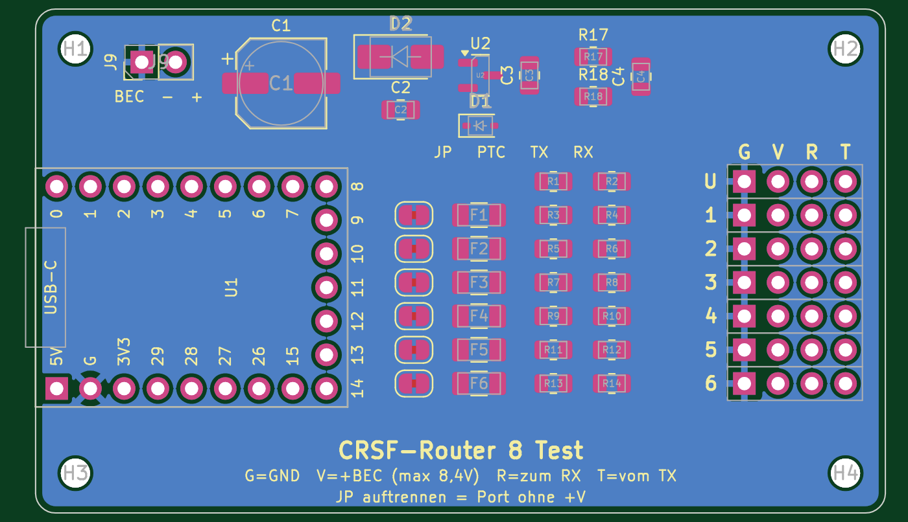
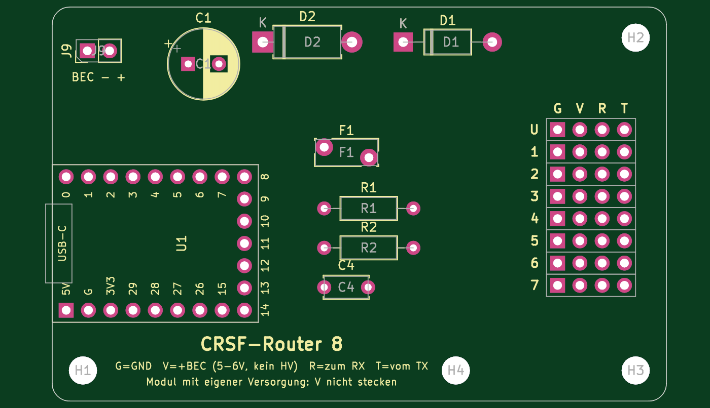
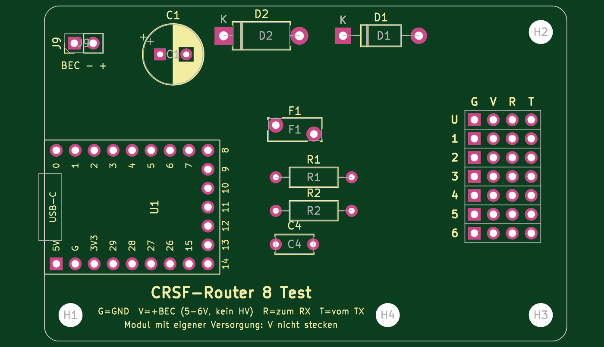

# Hardware CRSF-Router 8

Basis ist ein **Waveshare RP2350-Zero** (ca. 23,5 × 18 mm, USB-C, RGB-LED an GP16, BOOT- und RESET-Taste), gesteckt auf eine Verteilerplatine. Jeder Teilnehmer bekommt ein 4-poliges Kabel mit GND, +V und den beiden Signalen, wie bei einem Servoverteiler.

Es gibt zwei Versionen, jede mit eigenem KiCad-Projekt. Die Firmware ist für beide dieselbe, die Variante wird oben in `firmware/RC_CRSF_Router_RP2350/pins.h` gewählt.

| Version | Ordner | Ports | Pins am RP2350-Zero | Variante in pins.h |
|---|---|---|---|---|
| **Router** | [`Router/`](Router/) | Eingang + 7 Ports | alle: beide seitlichen Leisten **und** die 5 Pads unten (GP9–GP13) | `VARIANTE_ROUTER` (Vorgabe) |
| **Test** | [`Test/`](Test/) | Eingang + 6 Ports | nur die beiden seitlichen Leisten, Pads unten frei | `VARIANTE_TEST` |

> Stand v0.3 (05.11.2026): beide Schaltpläne und Platinen mit allen Bauteilen platziert, **noch nicht geroutet**. Footprint des RP2350-Zero vor der Bestellung am echten Board gegenprüfen. Mehr als 8 UARTs schafft der RP2350 nicht (2 Hardware-UARTs + 6 PIO-UARTs), deshalb sind 7 Ports das Maximum.

| Router (7 Ports) | Test (6 Ports) |
|---|---|
|  |  |

## Variante 2: nur bedrahtete Bauteile (THT)

Seit 05.11.2026 gibt es zu jeder Version eine **Variante 2** mit ausschließlich THT-Bauteilen, gut von Hand lötbar und einfacher zu routen. Variante 1 (SMD, Ordner `Router/` und `Test/`) bleibt unverändert.

| Version | Ordner V2 | Platine |
|---|---|---|
| Router (7 Ports) | [`Router-V2/`](Router-V2/) | 70 × 45 mm, 2 Lagen, 4 × M3 |
| Test (6 Ports) | [`Test-V2/`](Test-V2/) | 70 × 45 mm, 2 Lagen, 4 × M3 |

Vereinfachungen gegenüber Variante 1:

- **Kein Spannungsregler** (06.11.2026): Der RP2350-Zero bekommt das BEC über D1 (1N5819, ca. 0,3 V Verlust) direkt an seinen 5-V-Pin. **Deshalb nur BEC mit 5 bis 6 V, kein HV-BEC (7,4/8,4 V)!** D1 verhindert, dass USB den Bus speist.
- **Eine** Sicherung F1 (PTC 3 A) für alle Ports statt einer je Port, keine Lötbrücken JP und keine 220-Ω-Serienwiderstände. Statt über 30 sind es nur noch 9 Bauteile plus Stecker.
- D1 1N5819 (DO-41), D2 P6KE15CA (DO-15), Elko radial 8 mm, Scheibenkondensator RM 5, Widerstände RM 10,16.
- Breite Abstände, Leiterbahnen 0,4 mm (Power 1,0 mm), Abstand 0,3 mm. Damit lässt sich alles mit Freerouting oder von Hand verbinden.
- Port-Stecker ohne eigene Abschaltung: ein Modul mit eigener Versorgung bekommt einfach kein V-Kabel.

Erstes 3D-Modell (vereinfachte Körper, Maße aus der Platine): [`3d-modell-v2.html`](3d-modell-v2.html) herunterladen und im Browser öffnen (braucht Internet für die 3D-Bibliothek).

| Router V2 | Test V2 |
|---|---|
|  |  |

### Stückliste Variante 2

| Ref | Anzahl | Wert | Bauform | Hinweis |
|---|---|---|---|---|
| U1 | 1 | Waveshare RP2350-Zero | Buchsenleisten 2× 1×9 (+ 1× 1×5 bei Router) | gesteckt |
| D1 | 1 | 1N5819 | DO-41 | BEC zum 5-V-Pin, kein Rückstrom bei USB |
| D2 | 1 | P6KE15CA | DO-15 | Suppressordiode gegen Spannungsspitzen |
| F1 | 1 | PTC 3 A / 16 V, Bourns MF-RG300 | radial | gemeinsame Sicherung aller Ports |
| C1 | 1 | 220 µF / 16 V | Elko radial D 8 mm, RM 3,5 | |
| C4 | 1 | 100 nF | Keramik, RM 5 | Messeingang |
| R1 | 1 | 33 kΩ | 0,25 W axial, RM 10,16 | Spannungsteiler |
| R2 | 1 | 10 kΩ | 0,25 W axial, RM 10,16 | Spannungsteiler |
| J1–J8 / J1–J7 | 8 / 7 | Stiftleiste 1×4 | 2,54 mm, gerade | Router / Test |
| J9 | 1 | Stiftleiste 1×2 | 2,54 mm, gerade | BEC IN |
| H1–H4 | 4 | Bohrung M3 | | |

> Stand V2: Schaltplan fertig, Bauteile platziert, Netze geprüft, DRC ohne Abstandsfehler. **Noch nicht geroutet.** Abmessungen von F1 vor der Bestellung im Datenblatt prüfen. Versorgung nur mit BEC 5–6 V.

## KiCad-Projekte

Jeder Ordner enthält ein vollständiges Projekt:

| Datei | Inhalt |
|---|---|
| `RC-CRSF-Router-RP2350-<Version>.kicad_pro/.kicad_sch/.kicad_pcb` | Projekt, Schaltplan (A3), Platine 64 × 38 mm, 2 Lagen |
| `RC-CRSF-Router-RP2350-<Version>_Schaltplan.pdf` | Schaltplan als PDF |
| `Router8.kicad_sym`, `footprints.pretty/` | Projektbibliothek: Symbol und Footprint RP2350-Zero, Stiftleiste 1×4 für die Schiene |
| `sym-lib-table`, `fp-lib-table` | binden die Projektbibliothek ein |
| `vorschau-platine.png` | Bild der Platine von oben |

Erstellt im KiCad-7-Format, KiCad 9 öffnet und aktualisiert es beim ersten Speichern. Netzklassen: **Power** (GND, VBUS, +5V, +V der Ports) 1,0 mm, Rest 0,3 mm. Unterseite ist eine GND-Fläche.

**Nach dem Öffnen:** Routing (z. B. Freerouting), dann DRC. Der DRC meldet vor dem Routing nur offene Verbindungen und ein paar Hinweise zum Bestückungsdruck, keine Abstands- oder Hoffehler.

**RP2350-Zero bei der Router-Version:** An der unteren Kante hat das Board nur Lötpads (GP9–GP13). Dort eine kurze 5er-Stiftleiste einlöten, die Platine hat an dieser Stelle eine 5er-Buchse (Buchse auf drei Seiten). Bei der Test-Version bleibt die Kante frei, die Löcher für die 5er-Buchse sind im Footprint zwar vorhanden, werden aber nicht bestückt.

## Steckerleiste (2,54 mm, gerade)

| Reihe | Bedeutung |
|---|---|
| U (J1) | Uplink zum Empfänger, +V direkt am Bus (ohne Sicherung) |
| 1–7 (J2–J8) | Router: Port 1–7, +V über Lötbrücke JP und Sicherung F |
| 1–6 (J2–J7) | Test: Port 1–6, sonst gleich |

Spalten von links: **G** = GND (eckiges Pad), **V** = +BEC, **R** = Router sendet, an RX des Geräts, **T** = Router empfängt, vom TX des Geräts. Damit wird jedes Kabel gerade gesteckt.

## Pinbelegung RP2350-Zero

| Port | Router TX | Router RX | Test TX | Test RX |
|---|---|---|---|---|
| Uplink (Hardware-UART0) | GP0 | GP1 | GP0 | GP1 |
| Port 1 (PIO) | GP2 | GP3 | GP2 | GP3 |
| Port 2 (Hardware-UART1) | GP4 | GP5 | GP4 | GP5 |
| Port 3 (PIO) | GP6 | GP7 | GP6 | GP7 |
| Port 4 (PIO) | GP8 | GP9 | GP8 | GP14 |
| Port 5 (PIO) | GP10 | GP11 | GP15 | GP27 |
| Port 6 (PIO) | GP12 | GP13 | GP28 | GP29 |
| Port 7 (PIO) | GP14 | GP15 | – | – |
| Spannung | GP26 (Teiler 33k/10k) | | GP26 | |
| frei | GP27, GP28, GP29 | | GP9–GP13 (Pads) | |

Lage am Board (Oberseite, USB oben): rechte Leiste GP0–GP8, untere Kante GP9–GP13 (nur Pads), linke Leiste 5V, GND, 3V3, GP29, GP28, GP27, GP26, GP15, GP14.

## Stückliste

| Ref | Anzahl | Wert | Gehäuse | Hinweis |
|---|---|---|---|---|
| U1 | 1 | Waveshare RP2350-Zero | Buchsenleisten 2× 1×9 (+ 1× 1×5 bei Router), 2,54 mm | gesteckt |
| U2 | 1 | MCP1703A-5002E/CB | SOT-23 | 5-V-LDO, Eingang bis 16 V |
| D1 | 1 | B5819WS (Schottky) | SOD-323 | kein Rückstrom bei USB |
| D2 | 1 | SMAJ12CA (TVS) | SMA | 12 V Sperrspannung |
| C1 | 1 | 220 µF / 16 V | Elko SMD 6,3 × 7,7 | |
| C2, C3 | 2 | 1 µF / 25 V | 0805 | LDO Ein-/Ausgang |
| C4 | 1 | 100 nF | 0805 | Messeingang |
| R1–R16 / R1–R14 | 16 / 14 | 220 Ω | 0805 | Schutz der Signalleitungen |
| R17 | 1 | 33 kΩ | 0805 | Spannungsteiler |
| R18 | 1 | 10 kΩ | 0805 | Spannungsteiler |
| F1–F7 / F1–F6 | 7 / 6 | PTC 0,5 A / 15 V, z. B. Littelfuse 1206L050/15 | 1206 | für Soundmodul ggf. 1,1 A |
| JP1–JP7 / JP1–JP6 | 7 / 6 | Lötbrücke, geschlossen | Pads | auftrennen = Port ohne +V |
| J1–J8 / J1–J7 | 8 / 7 | Stiftleiste 1×4 | 2,54 mm, gerade | |
| J9 | 1 | Stiftleiste 1×2 | 2,54 mm, gerade | BEC IN, links −, rechts + |
| H1–H4 | 4 | Bohrung M2 | | |

Anzahlen: Router / Test. Werte aus dem Datenblatt-Gedächtnis, vor der Bestellung in den Datenblättern prüfen (besonders MCP1703A-Pinbelegung SOT-23A: 1 GND, 2 VOUT, 3 VIN).

## Versorgung

- **VBUS** = BEC bis 8,4 V, über J9 oder über die Reihe U vom Empfänger. Er geht ungeregelt an alle Ports, die Teilnehmer müssen diese Spannung also selbst vertragen.
- Der RP2350-Zero bekommt 5 V vom eigenen Regler U2 über D1. Steckt USB, verhindert D1 Rückstrom in den Regler.
- Jede Port-Sicherung F schaltet bei Kurzschluss nur ihren Port ab, der Empfänger läuft weiter. Nach Beseitigung des Fehlers schaltet sie selbst wieder ein.
- Hat ein Modul eine eigene Versorgung, die Lötbrücke JP seines Ports auftrennen, damit zwei Netzteile nicht gegeneinander arbeiten.
- Große Verbraucher (Lasten der Multiswitche, Lautsprecher-Verstärker) nicht über diese Platine versorgen.

## Spannungsmessung

R17/R18 teilen VBUS 4,3 : 1 auf GP26, C4 beruhigt den Messwert. Messbar bis ca. 14 V. Die Firmware sendet den Wert auf Wunsch als RxBt oder Zellenwert (Lua „Spannung senden“).
