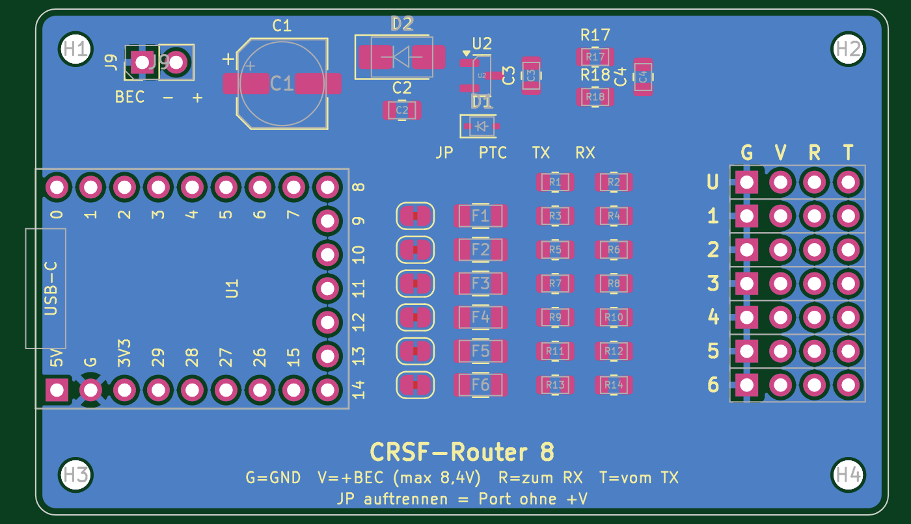

# Hardware CRSF-Router 8

Basis ist ein **Waveshare RP2350-Zero** (ca. 23,5 × 18 mm, USB-C, RGB-LED an GP16, BOOT- und RESET-Taste), gesteckt auf eine Verteilerplatine. Jeder Teilnehmer bekommt ein 4-poliges Kabel mit GND, +V und den beiden Signalen, wie bei einem Servoverteiler.

> Stand v0.2 (05.11.2026): nur die seitlichen Stiftleisten des RP2350-Zero, 1 Uplink + 6 Ports. Schaltplan und Platine mit allen Bauteilen platziert, **noch nicht geroutet**. Footprint des RP2350-Zero vor der Bestellung am echten Board gegenprüfen.

## KiCad-Projekt

| Datei | Inhalt |
|---|---|
| `RC-CRSF-Router-RP2350.kicad_pro/.kicad_sch/.kicad_pcb` | Projekt, Schaltplan (A3), Platine 64 × 38 mm, 2 Lagen |
| `RC-CRSF-Router-RP2350_Schaltplan.pdf` | Schaltplan als PDF |
| `Router8.kicad_sym`, `footprints.pretty/` | Projektbibliothek: Symbol und Footprint RP2350-Zero, Stiftleiste 1×4 für die Schiene |
| `sym-lib-table`, `fp-lib-table` | binden die Projektbibliothek ein |

Erstellt im KiCad-7-Format, KiCad 9 öffnet und aktualisiert es beim ersten Speichern. Netzklassen: **Power** (GND, VBUS, +5V, +V der Ports) 1,0 mm, Rest 0,3 mm. Unterseite ist eine GND-Fläche.

**Nach dem Öffnen:** Routing (z. B. Freerouting), dann DRC. Der DRC meldet vor dem Routing nur offene Verbindungen und ein paar Hinweise zum Bestückungsdruck, keine Abstands- oder Hoffehler.

## Steckerleiste (2,54 mm, gerade)

| Reihe | Bedeutung |
|---|---|
| U (J1) | Uplink zum Empfänger, +V direkt am Bus (ohne Sicherung) |
| 1–6 (J2–J7) | Port 1–6, +V über Lötbrücke JP und Sicherung F |

Spalten von links: **G** = GND (eckiges Pad), **V** = +BEC, **R** = Router sendet, an RX des Geräts, **T** = Router empfängt, vom TX des Geräts. Damit wird jedes Kabel gerade gesteckt.

## Pinbelegung RP2350-Zero

| Port | TX | RX |
|---|---|---|
| Uplink | GP0 | GP1 |
| Port 1 | GP2 | GP3 |
| Port 2 | GP4 | GP5 |
| Port 3 | GP6 | GP7 |
| Port 4 | GP8 | GP14 |
| Port 5 | GP15 | GP27 |
| Port 6 | GP28 | GP29 |
| Spannung | GP26 (Teiler 33k/10k) | |

Nur die beiden seitlichen Stiftleisten des RP2350-Zero werden benutzt (9 + 9 Pins). Die Lötpads an der unteren Kante (GP9–GP13) bleiben frei.

## Stückliste

| Ref | Anzahl | Wert | Gehäuse | Hinweis |
|---|---|---|---|---|
| U1 | 1 | Waveshare RP2350-Zero | Buchsenleisten 2× 1×9 + 1× 1×5, 2,54 mm | gesteckt |
| U2 | 1 | MCP1703A-5002E/CB | SOT-23 | 5-V-LDO, Eingang bis 16 V |
| D1 | 1 | B5819WS (Schottky) | SOD-323 | kein Rückstrom bei USB |
| D2 | 1 | SMAJ12CA (TVS) | SMA | 12 V Sperrspannung |
| C1 | 1 | 220 µF / 16 V | Elko SMD 6,3 × 7,7 | |
| C2, C3 | 2 | 1 µF / 25 V | 0805 | LDO Ein-/Ausgang |
| C4 | 1 | 100 nF | 0805 | Messeingang |
| R1–R14 | 14 | 220 Ω | 0805 | Schutz der Signalleitungen |
| R17 | 1 | 33 kΩ | 0805 | Spannungsteiler |
| R18 | 1 | 10 kΩ | 0805 | Spannungsteiler |
| F1–F6 | 6 | PTC 0,5 A / 15 V, z. B. Littelfuse 1206L050/15 | 1206 | für Soundmodul ggf. 1,1 A |
| JP1–JP6 | 6 | Lötbrücke, geschlossen | Pads | auftrennen = Port ohne +V |
| J1–J7 | 7 | Stiftleiste 1×4 | 2,54 mm, gerade | |
| J9 | 1 | Stiftleiste 1×2 | 2,54 mm, gerade | BEC IN, links −, rechts + |
| H1–H4 | 4 | Bohrung M2 | | |

Werte aus dem Datenblatt-Gedächtnis, vor der Bestellung in den Datenblättern prüfen (besonders MCP1703A-Pinbelegung SOT-23A: 1 GND, 2 VOUT, 3 VIN).

## Versorgung

- **VBUS** = BEC bis 8,4 V, über J9 oder über die Reihe U vom Empfänger. Er geht ungeregelt an alle Ports, die Teilnehmer müssen diese Spannung also selbst vertragen.
- Der RP2350-Zero bekommt 5 V vom eigenen Regler U2 über D1. Steckt USB, verhindert D1 Rückstrom in den Regler.
- Jede Port-Sicherung F schaltet bei Kurzschluss nur ihren Port ab, der Empfänger läuft weiter. Nach Beseitigung des Fehlers schaltet sie selbst wieder ein.
- Hat ein Modul eine eigene Versorgung, die Lötbrücke JP seines Ports auftrennen, damit zwei Netzteile nicht gegeneinander arbeiten.
- Große Verbraucher (Lasten der Multiswitche, Lautsprecher-Verstärker) nicht über diese Platine versorgen.

## Spannungsmessung

R17/R18 teilen VBUS 4,3 : 1 auf GP26, C4 beruhigt den Messwert. Messbar bis ca. 14 V. Die Firmware sendet den Wert auf Wunsch als RxBt oder Zellenwert (Lua „Spannung senden“).
