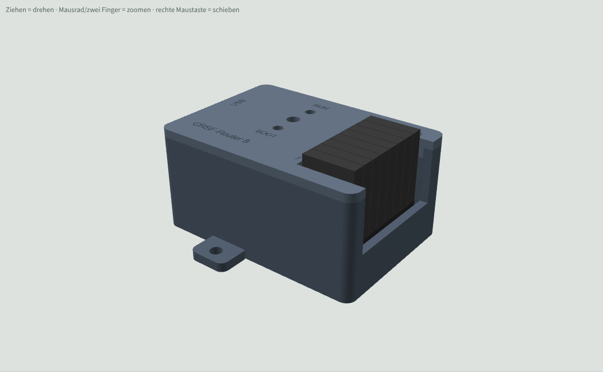
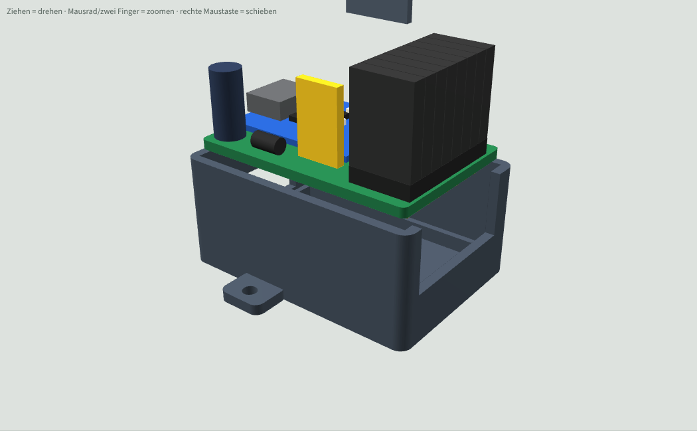

# Gehäuse CRSF-Router 8

3D-Druck-Gehäuse für die Router-Platine aus [`../Router/`](../Router/) (38,4 × 25,5 mm). Entwurf 1 vom 12.11.2026, noch nicht gedruckt.

| Geschlossen | Explosion |
|---|---|
|  |  |

3D-Ansicht zum Drehen: [`Gehaeuse3D_Vorschau.html`](Gehaeuse3D_Vorschau.html) herunterladen und im Browser öffnen (braucht Internet für die 3D-Bibliothek).

## Aufbau

- Außenmaß 42,2 × 29,3 × 20,3 mm (ohne Laschen), Wand, Boden und Deckel je 1,6 mm.
- Unterteil und Deckel werden zusammengeklipst (Lippe + 2 Rastnasen an den Längsseiten). Keine Schrauben, kein Kleben.
- Die Platine liegt auf einer 0,8 mm breiten Kante rundum, 2,5 mm über dem Boden. Vier Niederhalter am Deckel drücken sie an freien Stellen von oben (zwischen Zero und Leisten, Ecken rechts).
- **Links:** Öffnung für USB-C (12,6 × 7,2 mm, Platz für die Stecker-Umspritzung).
- **Steckerfeld U, 1–7:** oben und rechts offen, die rechte Wand reicht nur bis zur Oberkante der Stiftleisten. So lassen sich die acht 4-poligen Dupont-Stecker seitlich greifen. Beschriftung T R V G und U, 1–7 im Deckel.
- **Deckel:** Führungsrohre für BOOT und RUN (Büroklammer oder Zahnstocher), Lichtrohr über der RGB-LED.
- Zwei Laschen an den Längsseiten mit 2,4-mm-Loch (M2 oder Kabelbinder).
- Kollisionsprüfung Platine, Bauteile und Stecker gegen Gehäuse: 0 mm³ (`python gehaeuse.py . --pruefen`).

## Annahmen

- Die Höhe bestimmen F1 (PTC MF-RG300, bis 12,5 mm über der Platine angenommen) und C1 (Elko 5 × 11). Sitzen sie niedriger, Parameter `OBEN` in `gehaeuse.py` verkleinern.
- Lage von BOOT, RUN und LED aus dem Foto des RP2350-Zero geschätzt: 15,3 mm vom USB-Ende, Tasten 4,8 mm links und rechts der Mitte.

## Drucken

- PLA oder PETG, 0,2 mm Schicht (für die Schrift 0,12 mm), keine Stützen.
- Unterteil mit dem Boden aufs Bett, Deckel mit der Oberseite aufs Bett (die STL ist schon gedreht).
- Sitzt der Deckel zu stramm, `TOL` in `gehaeuse.py` von 0,15 auf 0,2 erhöhen.

## Dateien

| Datei | Inhalt |
|---|---|
| `Gehaeuse_Unterteil.stl` / `.step` | Unterteil |
| `Gehaeuse_Deckel.stl` / `.step` | Deckel (STL druckfertig gedreht) |
| `gehaeuse.py` | Quelle (CadQuery), alle Maße als Parameter oben in der Datei |
| `Gehaeuse3D_Vorschau.html` | 3D-Ansicht mit Platine und Steckern |

Neu erzeugen: `pip install cadquery`, dann `python gehaeuse.py .` in diesem Ordner.
